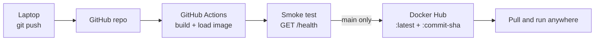

# Project 1 — Containerise and Ship a Web App

[](https://github.com/Delajeng/devops-project-01/actions/workflows/ci.yml)

A small Python Flask app packaged as a multi-stage Docker image. GitHub Actions builds it, smoke-tests it and pushes it to Docker Hub on every push to `main`, with no manual build steps.

This is the first project in my cloud DevOps series. The write-up is on my site: https://delajeng.dev/projects/containerise-and-ship/

## How it works



On every push and pull request the workflow:

1. Builds the image with Docker Buildx, using the GitHub Actions cache, and loads it into the runner's Docker.
2. Starts the container and calls `/health`. The test passes only if it returns `"status": "ok"` and the commit SHA the image was built from.
3. On `main` only, logs in to Docker Hub and pushes the tested image as `latest` and as the commit SHA.

Pull requests run steps 1 and 2 but never log in or push, so nothing untested reaches the registry.

## Repository layout

```
.
├── app/
│   ├── app.py              Flask app: / and /health
│   └── requirements.txt    Flask and Gunicorn, pinned
├── dockerfile              Multi-stage build, non-root user, Gunicorn on :8080
└── .github/workflows/
    └── ci.yml              Build, smoke test, push
```

## Run it locally

Requires Docker Desktop. From PowerShell in the repo folder:

```powershell
docker build -t devops-project-01 .
docker run -d -p 8080:8080 --name devops-project-01 devops-project-01
Invoke-RestMethod http://localhost:8080/health
```

The health check returns `status: ok` and `version: dev`. Local builds report `dev` unless you pass a version:

```powershell
docker build --build-arg APP_VERSION=local-test -t devops-project-01 .
```

Clean up with:

```powershell
docker rm -f devops-project-01
```

## Endpoints

| Path      | Returns |
| --------- | ------- |
| `/`       | A simple HTML page |
| `/health` | JSON: `{"status": "ok", "version": "<commit SHA or dev>"}` |

## CI setup

The workflow needs two repository secrets (**Settings → Secrets and variables → Actions**):

| Secret               | Value |
| -------------------- | ----- |
| `DOCKERHUB_USERNAME` | Docker Hub username |
| `DOCKERHUB_TOKEN`    | Docker Hub access token (not the account password) |

## Design decisions

- **Multi-stage build.** Dependencies are installed in a builder stage; only the installed packages are copied into the final `python:3.12-slim` image.
- **Non-root container.** The app runs as `appuser`.
- **Gunicorn, not the Flask dev server.** Two workers, bound to port 8080.
- **Test before push.** The image is loaded into the runner and tested first; the push step reuses the cached build.
- **Two tags.** `latest` for convenience and the commit SHA, so every image traces back to the exact code and can be rolled back to.
- **Version baked in.** `APP_VERSION` is set at build time and reported by `/health`, so you can see which commit is running.

## What I learned

- Writing a Dockerfile from scratch and what each instruction does
- Building, tagging and pushing images to a registry
- Why multi-stage builds give smaller, safer images
- GitHub Actions basics: triggers, jobs, steps and secrets
- Docker Hub compared with GitHub Container Registry
- Ordering a pipeline so a broken image never reaches the registry
